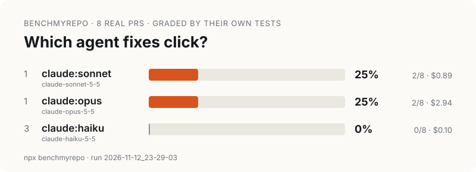

# benchmyrepo

**Which coding agent is actually best on _your_ code?** Public leaderboards measure someone else's repo. benchmyrepo takes your repo's own merged PRs, gives each one to the agents you already have installed, and grades them with the tests that shipped with the PR.

```bash
npx benchmyrepo init        # turn merged PRs into tasks
npx benchmyrepo run         # run every installed agent on them
```

### A real run: pallets/click, 2026-11-12

[](docs/first-run.md)

```
#  agent          solved  rate  cost   $/solve  median
1  claude:sonnet  2/8     25%   $0.89  $0.44    23s
1  claude:opus    2/8     25%   $2.94  $1.47    59s
3  claude:haiku   0/8     0%    $0.10  —        48s
```

Three Claude models (Claude Code 2.1.310: `claude-opus-5-5`, `claude-sonnet-5-5`, `claude-haiku-5-5`) on 8 [click](https://github.com/pallets/click) PRs merged from 2026-09-12 to 2026-11-12. Agents could edit files but not run commands. **This is one run on 8 tasks.** Sonnet and Opus solved the same 2 tasks and are tied; a sample this small can't rank them. Cost is the CLI's API-price estimate; the run used a subscription. The tasks were merged after Claude Opus 5.5's documented June 2026 knowledge cutoff; the Sonnet 5.5 and Haiku 5.5 cutoffs aren't verified. Full details, the task list, a hand check of the grader and the limitations are in [docs/first-run.md](docs/first-run.md).

You get a single-file `report.html`, a `leaderboard.svg` card to share, and a `badge.svg` for your README.

## Why it's different

- **Local, one command.** It runs in your dev environment, where your tests already pass. No accounts, no Docker images, no cloud.
- **Uses the agents you already pay for.** It drives `claude`, `codex`, `gemini` and `cursor-agent` in headless mode on your existing plans. You don't need API keys.
- **Graded by your real tests.** There's no LLM judge and no AI-written tests. A task counts only if the PR's tests **fail before** the fix and **pass with** the original fix on your machine.
- **No peeking.** Each agent works in a throwaway copy of the repo at the pre-PR commit, with no git history, so it can't look up the answer.
- **Your code stays on your machine.** It goes only to the agents you choose.

## How it works

1. **Mine.** It reads merged PRs with `gh` (or first-parent commits with `--source git`). It keeps PRs that change both source and test files, don't touch dependency manifests, and have a fix under 400 lines.
2. **Validate.** For each candidate, it makes a clean copy at the base commit, adds the PR's tests, and checks that they fail. Then it applies the PR's fix and checks that they pass.
3. **Run.** Each agent gets only the PR title, description and linked issues, with pasted diffs removed. It runs in its own copy.
4. **Grade.** The PR's test files are restored to their merged versions and run. Pass or fail is all that counts.

## Commands

```bash
npx benchmyrepo init   [--tasks 20] [--scan 200] [--since 2026-01-01] [--source github|git] [--test-cmd "…{files}"]
npx benchmyrepo tasks
npx benchmyrepo run    [--agents claude,claude:haiku,codex] [--tasks 10] [--concurrency 2] [--timeout 20] [--yolo]
npx benchmyrepo report [runId] [--open]
npx benchmyrepo doctor
```

- `agent:model` picks a model, for example `claude:opus` or `codex:gpt-5.5`.
- `--yolo` lets agents run shell commands such as your test suite without asking. Without it, Claude runs with edit permissions only, Codex runs in its workspace sandbox, and Gemini auto-approves edits only. Agents run on your machine, so only use `--yolo` on code you trust.
- Claude runs with `--setting-sources project,local`, so your personal hooks, `CLAUDE.md` and plugins don't change the result; the repo's own `.claude/` settings still apply. If you start benchmyrepo from inside an agent session, that session's variables aren't passed on to the agents.
- `--resume <runId>` continues an interrupted run.

### Custom agents

Add any CLI to `.benchmyrepo/config.json`:

```json
{ "agents": { "aider": "aider --yes-always --message-file {prompt_file}" } }
```

## Supported today

| | |
|---|---|
| Test runners | vitest, jest, mocha, `npm test`, `node --test`, pytest, `go test`, `cargo test` (or any command via `--test-cmd`) |
| Agents | Claude Code (tested on a real third-party repo, [pallets/click](docs/first-run.md)), Codex, Gemini CLI, cursor-agent (adapters written, not yet tested against the live CLIs), custom |
| Platforms | macOS, Linux; Node 20+ |

## Limitations

- PRs without tests can't become tasks. On many repos, most PRs get skipped (dependency bumps, docs).
- Public repos may be in a model's training data. Use `--since` to keep only PRs merged after a model's cutoff.
- Agents only get the PR description, but they are graded on every assertion in the PR's tests. Some of those check details the description never states, so a failure doesn't always mean broken code.
- A handful of tasks gives a rough signal, not a ranking. Look at the raw counts, and don't read a one-task difference as a win.
- Monorepos with per-package dependencies work if their `node_modules` are installed. PRs that change dependencies are skipped.
- Git submodules aren't copied into workspaces.

## Develop

```bash
npm install
npm test          # unit tests + an end-to-end run on a fixture repo with fake agents
```

MIT
