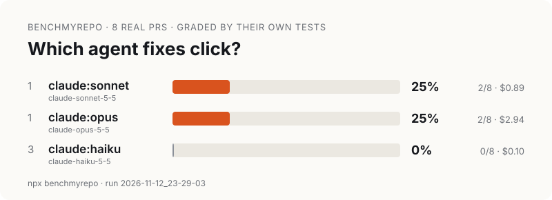

# benchmyrepo

**Which coding agent is actually best on _your_ code?** Public leaderboards measure someone else's repo. benchmyrepo takes your repo's own merged PRs, gives each one to the agents you already have installed, and grades them with the tests that shipped with the PR.

```bash
npx benchmyrepo init        # turn merged PRs into tasks
npx benchmyrepo run         # run every installed agent on them
```

### A real run: pallets/click, 2026-11-12

[](docs/first-run.md)

```
#  agent          solved  rate  cost   $/solve  median
1  claude:sonnet  2/8     25%   $0.89  $0.44    23s
1  claude:opus    2/8     25%   $2.94  $1.47    59s
3  claude:haiku   0/8     0%    $0.10  —        48s
```

Three Claude models (Claude Code 2.1.310: `claude-opus-5-5`, `claude-sonnet-5-5`, `claude-haiku-5-5`) on 8 [click](https://github.com/pallets/click) PRs merged from 2026-09-12 to 2026-11-12. Agents could edit files but not run commands. **This is one run on 8 tasks.** Sonnet and Opus solved the same 2 tasks and are tied; a sample this small can't rank them. Cost is the CLI's API-price estimate; the run used a subscription. The tasks were merged after Claude Opus 5.5's documented June 2026 knowledge cutoff; the Sonnet 5.5 and Haiku 5.5 cutoffs aren't verified. Full details, the task list, a hand check of the grader and the limitations are in [docs/first-run.md](docs/first-run.md).

You get a single-file `report.html`, a `leaderboard.svg` card to share, and a `badge.svg` for your README.

## Why it's different

- **Local, one command.** It runs in your dev environment, where your tests already pass. No accounts, no Docker images, no cloud.
- **Uses the agents you already pay for.** It drives `claude`, `codex`, `gemini` and `cursor-agent` in headless mode on your existing plans. You don't need API keys.
- **Graded by your real tests.** There's no LLM judge and no AI-written tests. A task counts only if the PR's tests **fail before** the fix and **pass with** the original fix on your machine.
- **No peeking.** Each agent works in a throwaway copy of the repo at the pre-PR commit, with no git history, so it can't look up the answer.
- **Your code stays on your machine.** It goes only to the agents you choose.

## How it works

1. **Mine.** It reads merged PRs with `gh` (or first-parent commits with `--source git`). It keeps PRs that change both source and test files, don't touch dependency manifests, and have a fix under 400 lines.
2. **Validate.** For each candidate, it makes a clean copy at the base commit, adds the PR's tests, and checks that they fail. Then it applies the PR's fix and checks that they pass.
3. **Run.** Each agent gets only the PR title, description and linked issues, with pasted diffs removed. It runs in its own copy.
4. **Grade.** The PR's test files are restored to their merged versions and run. Pass or fail is all that counts.

## Commands

```bash
npx benchmyrepo init   [--tasks 20] [--scan 200] [--since 2026-01-01] [--source github|git] [--test-cmd "…{files}"]
npx benchmyrepo tasks
npx benchmyrepo run    [--agents claude,claude:haiku,codex] [--tasks 10] [--concurrency 2] [--timeout 20] [--yolo]
npx benchmyrepo report [runId] [--open]
npx benchmyrepo readme [runId] [--file README.md] [--card .github/benchmyrepo/leaderboard.svg]
npx benchmyrepo doctor
```

- `agent:model` picks a model, for example `claude:opus` or `codex:gpt-5.5`.
- `--yolo` lets agents run shell commands such as your test suite without asking. Without it, Claude runs with edit permissions only, Codex runs in its workspace sandbox, and Gemini auto-approves edits only. Agents run on your machine, so only use `--yolo` on code you trust.
- Claude runs with `--setting-sources project,local`, so your personal hooks, `CLAUDE.md` and plugins don't change the result; the repo's own `.claude/` settings still apply. If you start benchmyrepo from inside an agent session, that session's variables aren't passed on to the agents.
- `--resume <runId>` continues an interrupted run.
- `readme` writes a run's card to `--card` and a short results table into your README, between a `<!-- benchmyrepo:start -->` line and a `<!-- benchmyrepo:end -->` line. The same run always produces the same files, so rerunning it leaves no diff.
- Your tests never see `ANTHROPIC_API_KEY`, `CLAUDE_CODE_OAUTH_TOKEN`, `CODEX_API_KEY`, `OPENAI_API_KEY`, `GEMINI_API_KEY`, `ANTHROPIC_AUTH_TOKEN` or `CURSOR_API_KEY`: they run code an agent wrote.

### Custom agents

Add any CLI to `.benchmyrepo/config.json`:

```json
{ "agents": { "aider": "aider --yes-always --message-file {prompt_file}" } }
```

## GitHub Action

> **Not yet run on GitHub-hosted runners.** Everything below is tested locally (unit tests, `actionlint`, and the action's steps run end to end against throwaway repos with fake agents), but the action itself has never run in GitHub Actions.

The action reruns the benchmark when a coding agent ships a new release and keeps the leaderboard card in your README up to date. It has three modes, meant for three jobs with different permissions:

| Mode | What it does | Needs |
|---|---|---|
| `check` | Asks npm for each agent's latest release and compares it with `.github/benchmyrepo/agent-versions.json`. Free. | `contents: read` |
| `bench` | Installs those exact agent versions, mines tasks from your merged PRs, runs the agents, grades them with your tests. Paid. | `contents: read`, `pull-requests: read`, an agent key |
| `readme` | Writes the card, the README block and the versions file from a run, and commits them as `github-actions[bot]` if they changed. | `contents: write`, no agent key |

Copy [`examples/benchmyrepo.yml`](examples/benchmyrepo.yml) to `.github/workflows/` in your repo, add your project's install step to the `bench` job (your tests must pass there), pin `moshejs/benchmyrepo` to a release commit SHA, and add these two lines to your README where the card should go:

```markdown
<!-- benchmyrepo:start -->
<!-- benchmyrepo:end -->
```

The action fails rather than guess if they are missing or out of order. Markers inside a code block, like the ones above, are ignored.

### When it runs

The example runs `check` daily and `bench` only when an agent has a release the card wasn't made with, or when you start it by hand with **force**.

| Agent | Release check | Source |
|---|---|---|
| `claude` | npm `@anthropic-ai/claude-code`, `latest` tag | `GET https://registry.npmjs.org/@anthropic-ai%2fclaude-code/latest` |
| `codex` | npm `@openai/codex`, `latest` tag | `GET https://registry.npmjs.org/@openai%2fcodex/latest` |
| `gemini` | npm `@google/gemini-cli`, `latest` tag | `GET https://registry.npmjs.org/@google%2fgemini-cli/latest` |
| `cursor-agent` | none | Cursor installs it with a shell script. The npm package named `cursor-agent` belongs to someone else. Runs only when started by hand, and an earlier step must install it. |
| custom agents | none | Started by hand only; install them in an earlier step. |

The endpoint is the npm registry's documented `GET /{package}/{version}` with `latest` as the version ([registry API](https://github.com/npm/registry/blob/main/docs/REGISTRY-API.md)). It needs no token. A model update that ships without a new CLI release isn't detected.

### Secrets

Pass only the ones for the agents you run, as action inputs. They reach one step, the one that runs the agents, and benchmyrepo removes them again before your tests run.

| Agent | Input | Secret | Source |
|---|---|---|---|
| `claude` | `anthropic-api-key` | `ANTHROPIC_API_KEY`, billed per token | [Claude Code env vars](https://code.claude.com/docs/en/env-vars) |
| `claude` | `claude-code-oauth-token` | `CLAUDE_CODE_OAUTH_TOKEN` from `claude setup-token`, uses a subscription | [Claude Code env vars](https://code.claude.com/docs/en/env-vars) |
| `codex` | `codex-api-key` | `CODEX_API_KEY` | [Codex non-interactive mode](https://learn.chatgpt.com/docs/non-interactive-mode) |
| `gemini` | `gemini-api-key` | `GEMINI_API_KEY` | [Gemini CLI authentication](https://github.com/google-gemini/gemini-cli/blob/main/docs/get-started/authentication.mdx) |

### Cost and time

benchmyrepo has no dollar budget. The action limits what it can: `tasks × agents` must not exceed `max-attempts` (default 20, 10 in the example), each attempt is killed after `timeout` minutes (default 15), and the example job stops after 90 minutes.

The only measured run is [the pallets/click run](docs/first-run.md): 24 attempts in 10 min 44 s at 2 at a time, $3.93 reported in all. Per attempt that was about $0.37 for `claude:opus`, $0.11 for `claude:sonnet` and $0.01 for `claude:haiku`, with medians of 23 to 59 s. Those are the CLI's API-price estimates for one small Python repo. At that rate the example (5 tasks × `claude:sonnet`) is about $0.55 per run, but cost on your repo is unknown until you measure it, and Codex and Gemini have never been measured. Mining also runs your tests twice per candidate PR, so a slow suite adds time but no API cost. On a hosted runner the job also uses Actions minutes.

### Security

- Agents run with edit permissions only; the action never passes `--yolo`.
- The `bench` job checks out with `persist-credentials: false`, so no agent can push. Only `publish` can write, and it runs no agent and holds no agent key. Only `meta.json`, `results.jsonl` and `report.html` travel between them as an artifact; per-attempt logs stay on the runner.
- Prompts include PR descriptions and linked issues, which anyone may have written on a public repo. Treat them as untrusted: keep the agents' permissions as they are and give the job no other secrets.
- No `pull_request` or `pull_request_target` trigger, and the jobs skip forks.
- Third-party actions in the example are pinned to full commit SHAs. Inputs reach the shell as environment variables, never interpolated into scripts.
- The commit is `Update benchmyrepo leaderboard [skip ci]`, never force-pushed. If the branch moved during the run, it rebases once and pushes.
- If every attempt by an agent errored (a missing CLI, a bad key), the run fails instead of publishing that agent at 0%.

To try the README step without running agents, point `readme` mode at a run you already have, such as the artifact of an earlier run, with `commit: false`.

## Supported today

| | |
|---|---|
| Test runners | vitest, jest, mocha, `npm test`, `node --test`, pytest, `go test`, `cargo test` (or any command via `--test-cmd`) |
| Agents | Claude Code (tested on a real third-party repo, [pallets/click](docs/first-run.md)), Codex, Gemini CLI, cursor-agent (adapters written, not yet tested against the live CLIs), custom |
| Platforms | macOS, Linux; Node 20+ |

## Limitations

- PRs without tests can't become tasks. On many repos, most PRs get skipped (dependency bumps, docs).
- Public repos may be in a model's training data. Use `--since` to keep only PRs merged after a model's cutoff.
- Agents only get the PR description, but they are graded on every assertion in the PR's tests. Some of those check details the description never states, so a failure doesn't always mean broken code.
- A handful of tasks gives a rough signal, not a ranking. Look at the raw counts, and don't read a one-task difference as a win.
- Monorepos with per-package dependencies work if their `node_modules` are installed. PRs that change dependencies are skipped.
- Git submodules aren't copied into workspaces.

## Develop

```bash
npm install
npm test          # unit tests + an end-to-end run on a fixture repo with fake agents
```

MIT
