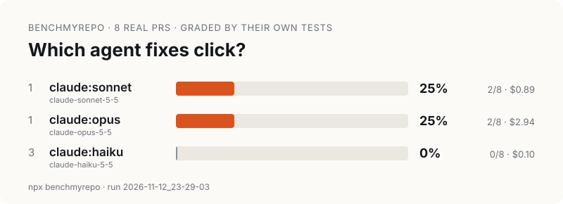

# First real run: pallets/click, 2026-11-12

The first time benchmyrepo ran real agents on a third-party repo. One run, three Claude models, eight tasks. **n is tiny.** Read the numbers as a smoke test of the tool, not as a ranking of the models.



Files: [`report.html`](first-run/report.html) (download it and open it locally; GitHub shows HTML files as source), [`leaderboard.svg`](first-run/leaderboard.svg), [`badge.svg`](first-run/badge.svg).

## Results

| Agent | Model id (reported by the CLI) | Solved | Rate | Reported cost | Median agent time | Tokens (in + out) |
|---|---|---|---|---|---|---|
| `claude:sonnet` | `claude-sonnet-5-5` | 2/8 | 25% | $0.89 | 23s | 1.57M |
| `claude:opus` | `claude-opus-5-5` | 2/8 | 25% | $2.94 | 59s | 3.55M |
| `claude:haiku` | `claude-haiku-5-5` | 0/8 | 0% | $0.10 | 48s | 3.41M |

- **Sonnet and Opus tie: 2 of 8 each, on the same two tasks.** Haiku solved none. Nothing here separates Sonnet from Opus, and 2/8 against 0/8 is too small a sample to rank Haiku below them with confidence.
- 20 of 24 attempts failed. Six of the eight tasks were solved by no model.
- Cost is what `claude -p --output-format json` reports in `total_cost_usd`: an API-price estimate. The run was on a Claude subscription plan, so nothing was billed per token. Total reported: **$3.93** for 24 attempts.
- Wall-clock time for the whole run: 10 min 44 s (23:29:03 to 23:39:47 UTC), 2 attempts at a time. No attempt came near the 15-minute timeout. The slowest was Opus on pr-3877 at 111 s.
- "Median" is the tool's median of 8 times: the upper of the two middle values.
- Tokens include cache reads, which dominate. Output tokens alone: Opus 41.8k, Sonnet 21.9k, Haiku 63.1k.

### Task by task

| Task | Merged | Fix size | Sonnet | Opus | Haiku |
|---|---|---|---|---|---|
| [#3902 Help pages no longer break a line within a hyphenated word](https://github.com/pallets/click/pull/3902) | 2026-11-12 | 113 lines | pass | pass | fail |
| [#3896 Add `context_settings` parameter to `CliRunner.invoke`](https://github.com/pallets/click/pull/3896) | 2026-11-06 | 16 | fail | fail | fail |
| [#3878 Print `\x04` and `\x1a` input bytes as `^D` and `^Z` in `CliRunner`](https://github.com/pallets/click/pull/3878) | 2026-11-06 | 38 | fail | fail | fail |
| [#3901 Stop passing a deprecated command's help text through `gettext`](https://github.com/pallets/click/pull/3901) | 2026-11-04 | 4 | pass | pass | fail |
| [#3884 Fix `show_envvar` output for a sequence or an empty `envvar`](https://github.com/pallets/click/pull/3884) | 2026-10-06 | 23 | fail | fail | fail |
| [#3877 Add `Parameter.spec` and deprecate `human_readable_name`](https://github.com/pallets/click/pull/3877) | 2026-10-04 | 133 | fail | fail | fail |
| [#3860 Always list all positional arguments](https://github.com/pallets/click/pull/3860) | 2026-09-21 | 32 | fail | fail | fail |
| [#3865 Fix short help abbreviation](https://github.com/pallets/click/pull/3865) | 2026-09-12 | 52 | fail | fail | fail |

"Fix size" is the lines the PR changed in source files (added + removed), not counting tests and docs.

## Setup

| | |
|---|---|
| Target | [pallets/click](https://github.com/pallets/click) (BSD-3-Clause), checked out at `e38188e9e205005d5af5f9e59df51904c984586a` (main, 2026-11-12) |
| Tool | benchmyrepo 0.1.0 plus the fixes listed below (built from this repo at the commit that adds this file) |
| Agent CLI | Claude Code `2.1.310`, signed in with a subscription, run headless with `claude -p` |
| Models | aliases `opus`, `sonnet`, `haiku`, resolved by the CLI to `claude-opus-5-5`, `claude-sonnet-5-5`, `claude-haiku-5-5`. Effort was not set, so each model ran at the CLI's default. |
| Permissions | `--permission-mode acceptEdits`, no `--yolo`: agents could read and edit files in their workspace but could not run commands, so they could not run the tests. |
| Agent config | `--setting-sources project,local --no-session-persistence`: no user-level hooks, CLAUDE.md or plugins (click has no project-level `.claude/` settings) |
| Python | 3.14.10 in a uv venv with `pytest==9.0.2` (click's `uv.lock` pin). Click's own dist-info was installed for `importlib.metadata`, with its source removed from the venv, so tests import the workspace's `src/`. |
| Machine | macOS (Apple silicon), Node 26 |

Commands, run in the click checkout:

```bash
npx benchmyrepo init --since 2026-09-01 --tasks 8 --scan 200 --concurrency 1
npx benchmyrepo run --agents claude:opus,claude:sonnet,claude:haiku --tasks 8 --concurrency 2 --timeout 15
```

Test command (detected): `.venv/bin/python -m pytest -q -p no:cacheprovider {files}`, with `PYTHONPATH={workspace}/src:{workspace}`.

### Why click

- Public and permissively licensed (BSD-3-Clause), widely used, and small enough that the whole suite runs in about 4 seconds with no services, network or secrets.
- Its only test dependency is pytest, and installing it runs no install scripts (wheels only).
- Recent PRs often change source and tests together, with a description that says what to build. benchmyrepo found 10 such PRs among the first 24 it examined.
- It wasn't the owner's repo, and the first candidate gave enough tasks, so no second candidate was tried.

### Why `--since 2026-09-01`

Public repos may be in a model's training data. Anthropic's model documentation gives a June 2026 knowledge cutoff for Claude Opus 5.5. I found no published cutoff for Sonnet 5.5 or Haiku 5.5. All eight tasks were merged between 2026-09-12 and 2026-11-12, two to five months after the documented Opus cutoff. That makes it unlikely that any model saw these fixes, but the Sonnet and Haiku cutoffs are not verified.

### Funnel

```
32 PRs merged since 2026-09-01 → 24 examined → 10 changed source + tests → 8 validated → 8 not examined (--tasks 8 reached)
Skipped: 7 no test changes, 4 merge one branch into another, 2 change dependencies, 2 tests already pass without the fix, 1 no source changes
```

"Validated" means the PR's tests fail at the pre-PR commit and pass with the PR's own fix, on this machine.

## Hand check of the grader

Grading should depend only on the PR's tests. To confirm that, I regraded attempts without any benchmyrepo code: extract the pre-PR commit with `git archive`, apply the agent's patch from the run logs, copy the PR's test files from the merge commit, and run pytest. **All 24 attempts gave the same pass/fail as benchmyrepo.** Four in detail:

- **#3901, Opus: pass (correct).** The PR stops passing a deprecated command's help text through `gettext`; only the `(DEPRECATED)` label should be translated. Opus removed `_()` from both places in `Command` that wrapped the help text, `get_short_help_str` and `format_help_text`, the same two lines the PR changed, and added a changelog entry. PR tests: `104 passed`.
- **#3901, Haiku: fail (correct).** Haiku fixed `get_short_help_str` but not `format_help_text`. The PR's `test_deprecated_help_text_is_not_translated` installs a translator that upper-cases text, and the full help page still read `SUB HELP (DEPRECATED: REASON)`. PR tests: `1 failed, 103 passed`. This is a real, incomplete fix.
- **#3902, Sonnet: pass (correct).** PR tests: `215 passed`.
- **#3878, Opus: fail (correct).** The PR says `\x04` and `\x1a` are echoed as `^D`/`^Z` and "no longer passes these bytes to the command". Opus got the echo right, but a command that reads stdin with `readlines()` still saw a third line. The test expects `bar\nbaz\n^D\n2\n` and got `...^D\n3\n`. This is a real gap against the stated behaviour.

Why the other tasks failed for every model (from the test output in the run logs):

- **#3884**: the PR's table says an empty `envvar` (`""` or `[]`) shows the same help as no `envvar`. The tests go further: with `auto_envvar_prefix` set, an empty `envvar` must fall back to the automatic variable name, the way `envvar=None` does. All three models hid the hint and failed those two cases. The PR text implies this behaviour but never states it.
- **#3896**: the hidden tests require a `TypeError` when the same setting is passed both in `extra` and in `context_settings`. The PR description doesn't mention it. All three models merged the two silently and failed only that test (`1 failed, 328 passed`).
- **#3877**: the tests require a `DeprecationWarning` when a subclass overrides `human_readable_name`. All three models missed it. Sonnet also got `spec` wrong for options (`times` instead of `--times`).
- **#3860**: wrong output on the PR's own examples. Opus printed `(DEPRECATED)` twice for a deprecated argument. Sonnet's `get_help_record` still returned `None` for an argument without help. Haiku kept a "Positional arguments" section where the tests expect none.
- **#3865**: Sonnet and Haiku rewrote the function around `textwrap.shorten`, which raises `ValueError` on widths shorter than its placeholder. Opus's version cut `123 567 9.` where the tests expect `123 567...`.

Several of these failures are details that only the PR's tests spell out. That is how this method works: an agent that can't run tests, given only the PR description, is held to every assertion the maintainers wrote. Agents were not allowed to run commands. With `--yolo` they could run the existing suite, though not the hidden tests, and might do better.

## Limitations

- **n = 8 tasks, one repo, one run, no repeats.** There is no variance estimate. Rerunning the same command could move any model by a task or two. Sonnet and Opus are tied, and no claim is made about which is better.
- **Possible training-data exposure.** All tasks were merged after Opus 5.5's documented June 2026 cutoff. The Sonnet 5.5 and Haiku 5.5 cutoffs are not verified (see above).
- **Underspecified tasks.** Some hidden tests check behaviour that the PR description only implies (see #3884 and #3896). A low solve rate here means "didn't reproduce the maintainers' exact change", not always "wrote broken code".
- **No shell for the agents.** This was the tool's safe default. It measures what a model does from the description alone. Results with `--yolo` would differ.
- **Cost is the CLI's estimate**, not a bill. Subscription runs aren't billed per token.
- **Claude only.** The Codex, Gemini CLI and cursor-agent adapters have still never run against the live CLIs.

## Bugs this run found in benchmyrepo (fixed in the same PR)

1. **Branch-merge PRs became tasks.** "Merge stable into main" (#3910, 17 test files, 185 lines) was accepted as a task whose instruction was just its title. Now PRs from long-lived branches (`stable`, `main`, `8.3.x`…) or titled "Merge X into Y" are skipped.
2. **Helper files were run as tests.** Every file under `tests/` was handed to pytest, including click's `tests/typing/*.py` mypy inputs. pytest collected them and failed on `import typing_extensions`, so #3858 was wrongly rejected as "fails even with the fix". Rerun with the fix, #3858 validates; it wasn't used because `--tasks 8` was already reached. Now only files a runner would pick up on its own are run (`test_*.py`, `*.test.ts`, `*_test.go`, plain `.js` files in `test/`). Helpers, fixtures and snapshots are still installed with the hidden tests.
3. **Agents inherited the parent agent's session.** Run from inside Claude Code, every `claude -p` inherited `CLAUDECODE`, `CLAUDE_CODE_ENTRYPOINT`, `CLAUDE_CODE_SESSION_ID`, `CLAUDE_CODE_CHILD_SESSION`, `CLAUDE_EFFORT` and 30 other session variables (35 in all on this machine). Those are now stripped. Configuration variables such as `ANTHROPIC_API_KEY` and `CLAUDE_CODE_USE_BEDROCK` are kept.
4. **Agents ran with the user's personal Claude setup.** That meant user-level `CLAUDE.md`, hooks (on this machine, one runs `tsc` after edits and one tells Claude to commit before stopping), plugins and default model. A probe confirmed the user's `CLAUDE.md` reached the agent. Claude now runs with `--setting-sources project,local` and `--no-session-persistence`.
5. **An agent that committed would score as "no changes".** The diff was taken against `HEAD`, so a committed fix vanished, and test files were restored from the agent's commit instead of the base. Both now use a tag on the workspace's starting commit.
6. **The card counted every task on disk**, not the run's tasks.
7. **Ties were shown as wins.** The card, the badge and the table ranked the cheaper of two tied agents first and highlighted only that one. Tied agents now share the rank and the highlight, and the badge names both.
8. Smaller fixes: `init` prints the funnel and keeps the test output of rejected candidates in `.benchmyrepo/rejected/`. `doctor` shows CLI versions and whether `claude` is signed in. Each run records the tool and CLI versions, and the report shows them.

The grading fixes (1, 2, 5) and the agent-isolation fixes (3, 4) were in place before the run above. The run was done once, after them. The report fixes (6, 7) only re-rendered the same `results.jsonl`.
